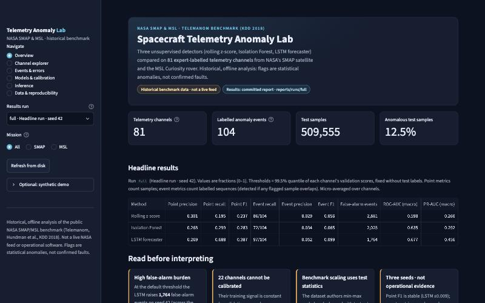
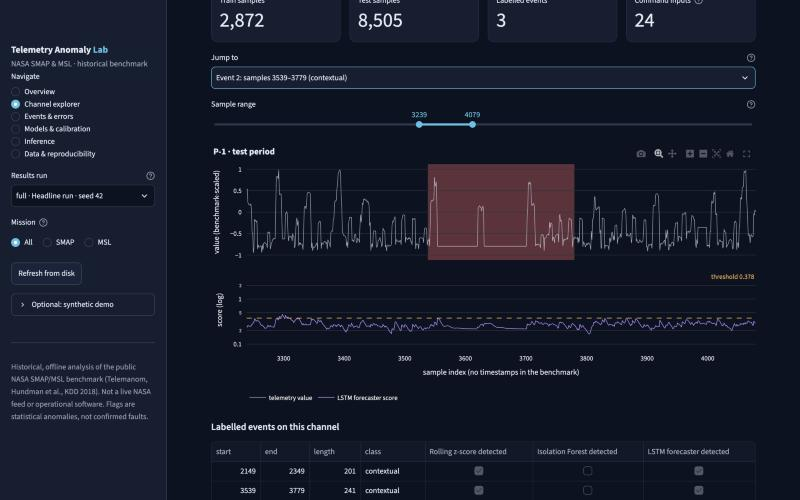
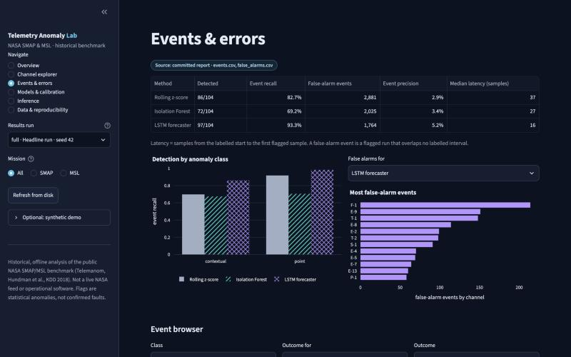

# NASA Spacecraft Telemetry Anomaly Detection Using Machine Learning and LSTM Networks

**Spacecraft Telemetry Anomaly Lab**: a reproducible comparison of three unsupervised anomaly detectors (rolling
z-score, Isolation Forest and an LSTM forecaster) on the public **NASA SMAP & MSL telemetry benchmark**
(Hundman et al., KDD 2018, "Telemanom"). It covers 81 expert-labelled channels from the SMAP satellite and the MSL
Curiosity rover, evaluated with point- and event-level metrics, calibration studies and seed variance, plus an
interactive dashboard and a verified download-and-reproduce workflow.

> **Scope.** Historical, offline benchmark analysis. This is not a live NASA feed, NASA software, or a fault-diagnosis
> system, and NASA does not endorse it. A flagged "anomaly" is a statistically unusual sample, not a confirmed fault.
> The benchmark has no timestamps, units or subsystem names, so everything is indexed by sample number.



## Quick start (about 3 minutes, no data download)

```bash
git clone https://github.com/SJ-Hariharan/nasa-telemetry-anomaly-detection.git
cd nasa-telemetry-anomaly-detection
python3.11 -m venv .venv && source .venv/bin/activate
pip install -r requirements.txt        # CPU-only; works on Apple Silicon. requirements-lock.txt = exact versions used
streamlit run app/dashboard.py         # opens http://localhost:8501
```

The dashboard opens on the **real NASA benchmark results**, read from reports committed in this repository: the
headline comparison, seed variability, calibration studies, per-channel and per-event analysis, and every caveat.
Nothing is downloaded or trained when the page loads.

| Page | Fresh clone (committed reports) | After `download` (~170 MB) | After a local training run |
|---|---|---|---|
| Overview | ✓ results, seed error bars, caveats | | |
| Channel explorer | ✓ labelled-event timeline per channel | ✓ real train/test telemetry | ✓ model scores, thresholds and flags overlaid |
| Events & errors | ✓ all 104 events, false alarms, latency | ✓ each event plotted in context | ✓ with scores |
| Models & calibration | ✓ all vs calibratable, seeds, leave-channels-out, bootstrap | | |
| Data & reproducibility | ✓ status, one-click download/validate/reproduce | | |
| Inference | guidance only | | ✓ score a CSV or a test file with a saved model |

## Explore the real NASA telemetry

In the dashboard, open **Data & reproducibility** → *Download and verify NASA data*, or use the command line:

```bash
python -m src.cli download     # ~170 MB, 1-5 min; pinned mirror, SHA-256 verified per file; resumable
python -m src.cli validate     # seconds; shapes, labels, ranges -> reports/data_validation.json
```

Then click **Reload data**. The Channel explorer plots the real train/test values of any SMAP or MSL channel, with
the historical expert-labelled anomaly intervals.



## Reproduce the results on your machine (CPU)

| Run | What | Time (Apple M1, CPU) | Disk | How |
|---|---|---|---|---|
| Quick check | 3 real channels, tiny model; proves the pipeline works here (metrics not meaningful) | ~30 s | small | dashboard button, or `python -m src.cli all --config configs/reproduce_smoke.yaml` |
| Full benchmark | 81 channels, all three detectors, published settings (seed 42) | ~1–2 h | ~20 MB scores + ~190 MB models | dashboard button (needs a confirmation tick), or `python -m src.cli all --config configs/reproduce.yaml --resume` |

Dashboard-started runs continue in the background if you close the tab, and show live progress. `--resume` (or
starting again) continues an interrupted run. They write to new run folders (`reproduce_smoke`, `reproduce`, both
gitignored), so the committed reports are never overwritten. When a run finishes, click *Load results* on the
Data page (or pick the run in the sidebar). Then:

```bash
python -m src.cli calibration --run reproduce                # threshold bootstrap + leave-channels-out (~15 s)
python -m src.cli predict --run reproduce --method lstm --channel P-1 --input my.csv --output scored.csv
```

`predict` reuses the saved scaler and threshold (never refits). Malformed input is rejected with a message and exit
code 2. It warns when commands are missing, when values are out of range, or when the channel's threshold is not a
real calibration. Saved Isolation Forest models are joblib (pickle) files: only load `models/` folders you produced.

## Results (full run: 81 channels, thresholds calibrated without labels)

| Method | Point precision | Point recall | Point F1 | Event recall | Event F1 | False-alarm events | ROC-AUC (macro) | PR-AUC (macro) |
|---|---|---|---|---|---|---|---|---|
| Rolling z-score | 0.301 | 0.195 | 0.237 | 0.827 (86/104) | 0.056 | 2,881 | 0.590 | 0.260 |
| Isolation Forest | 0.268 | 0.299 | 0.283 | 0.692 (72/104) | 0.065 | 2,025 | 0.635 | 0.292 |
| **LSTM forecaster** | 0.269 | **0.688** | **0.387** | **0.933 (97/104)** | **0.099** | **1,764** | **0.677** | **0.456** |

The LSTM catches 97 of 104 labelled events (median latency 16 steps) and has the best PR-AUC. Its ROC-AUC lead
over Isolation Forest is within the bootstrap intervals. Every method raises far too many alarms. 22 channels
cannot be calibrated at all (constant training signal, threshold ≈ 0), and they account for 52% (baseline) and
44% (LSTM) of the point false positives. On the 59 calibratable channels, LSTM point F1 is 0.425. Validation-to-test score shift (KS statistic)
explains part of the rest. Details, both tables, error analysis and a post-hoc sensitivity study: [`EXPERIMENTS.md`](EXPERIMENTS.md).
No hyper-parameter search. **Not a replication of the Telemanom paper.**

**Calibration studies** (on saved scores, no retraining; `reports/runs/full/calibration/`):
* *Threshold uncertainty.* Every threshold comes from a small validation set (fewer than 5 expected exceedances
  per channel). A block bootstrap of those sets moves the aggregate results by about 0.01–0.05 in F1 (LSTM F1
  [0.375, 0.389]). That is real but small next to the precision gap. The ranges are lower bounds (see EXPERIMENTS).
* *Leave-channels-out calibration.* A threshold rule chosen on other channels (5 folds, pre-specified rule
  family and objective) and applied to held-out channels cuts LSTM false-alarm events from 1,764 to 332 and lifts
  event F1 from 0.099 to 0.231 across all 81 channels. Event recall falls from 0.933 to 0.548. On the 59 calibratable
  channels the gain is smaller (0.077 → 0.150), and the LSTM is not always the best method there. The chosen rule
  sits at the edge of the grid. This is an estimate for new channels, not a re-tuned headline number.

**Seed variance** (seeds 42, 1, 2; `reports/seed_summary.json`). LSTM point F1 is 0.390 ± 0.009 and macro
ROC-AUC 0.682 ± 0.007, so point-level results are stable. Event-level results are not: false-alarm events range
1,764–2,897 and event F1 0.063–0.099. The seed-42 run in the table above is the most favourable of the three on
event F1 and false alarms. The leave-channels-out improvement holds on every seed.



## Data source, citation and licences

* **Data:** NASA SMAP and MSL telemetry released with the Telemanom benchmark. Values are anonymised and min-max
  scaled by the dataset authors (using test-set statistics, a known benchmark property; see
  [`docs/limitations.md`](docs/limitations.md)).
* **Labels:** historical expert annotations derived from incident reports (`labeled_anomalies.csv`). Boundaries are
  approximate; T-10 has no labels; P-2's duplicate rows are merged.
* **Provenance:** the original S3 archive now returns HTTP 403, so the downloader uses the Hugging Face mirror
  `lxr11111/telemanom` pinned to one commit, verifies every file's SHA-256, and cross-checks the labels against
  the canonical repository ([`docs/dataset.md`](docs/dataset.md)).
* **Cite:** K. Hundman, V. Constantinou, C. Laporte, I. Colwell, T. Söderström. *Detecting Spacecraft Anomalies
  Using LSTMs and Nonparametric Dynamic Thresholding.* KDD 2018 ([arXiv:1802.04431](https://arxiv.org/abs/1802.04431)).
  Code: [github.com/khundman/telemanom](https://github.com/khundman/telemanom).
* **Licences:** this project's code is MIT ([`LICENSE`](LICENSE)). The data is © Caltech under BSD-3-clause-style
  terms and is downloaded separately, never committed.

## Optional: synthetic demo (not NASA data)

`python -m src.cli demo` runs the whole pipeline in about 30 seconds on 4 **synthetic** channels with hand-made
anomalies, for trying the code with no download at all. It is hidden in the dashboard unless you enable *Show the
synthetic demo run* in the sidebar, and every page then carries a red *SIMULATED DEMO — NOT NASA BENCHMARK
RESULTS* banner. Its outputs go to `data/demo/`, `reports/runs/demo/` and `models/demo/` (gitignored), and it
never touches NASA runs. It demonstrates the workflow only, never NASA performance.

## Troubleshooting

| Symptom | Fix |
|---|---|
| `streamlit: command not found` | Activate the venv (`source .venv/bin/activate`) or run `python -m streamlit run app/dashboard.py`. |
| Dashboard looks unstyled / light | Start it from the repository root so `.streamlit/config.toml` is found. |
| Download fails with `CERTIFICATE_VERIFY_FAILED` | Update to this version (it verifies with `certifi`), or `pip install -r requirements.txt`. On python.org macOS Python you can also run *Install Certificates.command*. |
| Download fails or is slow | Re-run `python -m src.cli download`: it resumes and re-verifies. A proxy that truncates large files shows as a checksum error, which is a refusal, not corruption. |
| Explorer says "Telemetry: not downloaded" after downloading | Click **Reload data** in the sidebar. |
| Inference page shows guidance only | Saved models are generated locally: run the quick check or the full reproduction first. |
| A run shows "stopped" | The machine slept or rebooted. Start it again: completed channels are skipped. |
| Port 8501 busy | `streamlit run app/dashboard.py --server.port 8502` |

## Deployment

The project is built to run **locally** (`streamlit run app/dashboard.py`); no hosted instance is provided.
A static host such as Streamlit Community Cloud could serve the committed-report views (Overview, Models &
calibration, event tables) because they need no data. Downloading 170 MB and training for an hour are not
suitable for free hosted tiers, and a public instance should disable those buttons. Anything hosted remains a
historical benchmark viewer, not a monitoring service.

## Development

```bash
pytest -q                               # ~1-2 min, offline; unit, integration, dashboard (AppTest), demo
git config core.hooksPath .githooks     # pre-commit: whitespace/secrets/data/size/syntax; pre-push: test suite
```

## How it works

```
download → validate → EDA → chronological split of TRAIN (80% fit / 20% validation) → train-only scaling
→ windows / features → {rolling z-score | Isolation Forest | LSTM forecaster} → anomaly scores
→ per-channel threshold = 99.5% quantile of VALIDATION scores → predictions on TEST
→ point + event metrics, error analysis → dashboard / saved models → inference
```

| Method | Score at timestep t |
|---|---|
| Rolling z-score | distance of x_t from the mean of the previous 100 points, in rolling standard deviations |
| Isolation Forest | how easily random trees isolate the trailing-window feature vector at t |
| LSTM | smoothed absolute error of a one-step-ahead forecast made from the previous 100 timesteps (value + commands) |

Test labels are attached only after every model has predicted. A test changes the labels and checks that
no threshold moves.

## Repository layout

```
src/data/            download (pinned + verified), loader, validation
src/preprocessing/   chronological split, train-only scaler
src/features/        causal windows and Isolation Forest features
src/models/          detectors, LSTM, thresholds, persistence
src/evaluation/      metrics (point/event/AUC), evaluation + error analysis + figures,
                     calibration studies (threshold bootstrap, leave-channels-out, seed summary)
src/inference/       input validation + scoring with saved models
src/pipeline.py      per-channel training/scoring orchestration
src/cli.py           command-line entry point
src/demo.py          offline demo: synthetic telemetry generator + end-to-end run (SIMULATED, not NASA data)
app/dashboard.py     Streamlit + Plotly dashboard ("Spacecraft Telemetry Anomaly Lab"); app/lab_theme.py visual system
.streamlit/          dashboard theme
src/jobs.py          background reproduction runs started from the dashboard (explicit click, lock, progress)
configs/             default.yaml (full), smoke.yaml (quick), seed1.yaml / seed2.yaml (seed variance),
                     reproduce*.yaml (local reproductions), demo.yaml (synthetic demo)
notebooks/           exploratory_analysis.ipynb (executed)
reports/             data_validation.json, figures/, runs/<run>/ (metrics, tables, figures)
models/              saved per-channel detectors (generated)
tests/               unit, integration, dashboard tests
.githooks/           pre-commit (fast hygiene checks) and pre-push (test suite) hooks
docs/                architecture, methodology, dataset, limitations, learning/ (9 teaching notes)
```

## Status

| Component | State |
|---|---|
| Download (pinned, SHA-256 verified), validation, EDA notebook | Implemented, run on real data |
| Preprocessing, three detectors, thresholds, evaluation, error analysis | Implemented, full run on 81 channels |
| Persistence + inference (`predict` CLI, dashboard upload) | Implemented, round-trip tested |
| Dashboard: NASA-first, 6 pages, provenance labels, mission filter, one-click download/validate/reproduce | Implemented; AppTest for routes, data states and demo separation; checked in a browser at desktop and phone width |
| Offline first-run demo on simulated data (`python -m src.cli demo`) | Implemented; tested offline in a clean copy (deterministic, labelled SIMULATED, real runs untouched) |
| Resume after interruption (`--resume`) | Implemented, tested |
| Tests | Unit + integration + dashboard (`pytest -q`) |
| Calibration status, macro AUC with CIs, validation-vs-test shift (KS) | Implemented, tested (review fixes D1–D3, D6) |
| Threshold-uncertainty bootstrap, leave-channels-out calibration | Implemented on saved scores, tested |
| Seed variance (seeds 42, 1, 2) | Done: 3 complete 81-channel runs, `python -m src.cli seeds` |
| Hyper-parameter search / cross-channel models | **Not done** |
| Nonparametric dynamic thresholding (Telemanom) | **Not implemented** |
| GPU training, real-time streaming ingestion | **Not implemented** (offline CPU only) |

## Files to study first (suggested reading order)

1. `docs/dataset.md`, then `notebooks/exploratory_analysis.ipynb`: what the data is and why it is tricky.
2. `src/data/loader.py`: file format, inclusive label intervals, the P-2 merge.
3. `src/preprocessing/scaling.py` and `src/features/windows.py`: leakage control and the alignment convention.
4. `src/models/detectors.py`: the shared interface; the baseline and Isolation Forest.
5. `src/models/lstm.py`: forecaster, training loop, early stopping, error → score.
6. `src/models/thresholds.py`: from scores to decisions.
7. `src/pipeline.py`: how the pieces are ordered (labels last).
8. `src/evaluation/metrics.py`, then `evaluate.py`: point vs event metrics, error analysis.
9. `src/models/persistence.py`, then `src/inference/predict.py`: saving, loading, safe inference.
10. `app/dashboard.py`; then `tests/` to see each guarantee pinned down.

Teaching notes: `docs/learning/` · decisions and mistakes: `LEARNING_LOG.md` · results: `EXPERIMENTS.md`.

## References

* K. Hundman et al. *Detecting Spacecraft Anomalies Using LSTMs and Nonparametric Dynamic Thresholding.* KDD 2018.
* Telemanom: https://github.com/khundman/telemanom · Data mirror: https://huggingface.co/datasets/lxr11111/telemanom
* F. T. Liu, K. M. Ting, Z.-H. Zhou. *Isolation Forest.* ICDM 2008.
* S. Hochreiter, J. Schmidhuber. *Long Short-Term Memory.* Neural Computation 1997.

Code: MIT (see `LICENSE`). Data: Caltech, BSD-3-clause-style terms, downloaded separately.
